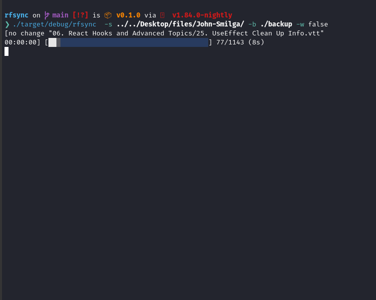

# rfsync
lightweight local file synchronization tool

# usage
you can use this dummy tool by running:
```bash
git clone https://github.com/natifessh/rfsync.git
cd rfsync
cargo run -- -s your/source_dir -b your/dest_dir
```


future plans

-- remote backup using ssh/scp

-- make the watacher logic with notify 

... 